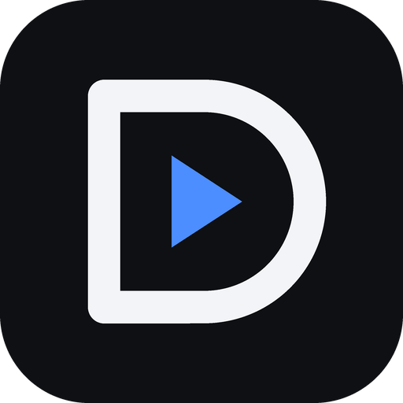
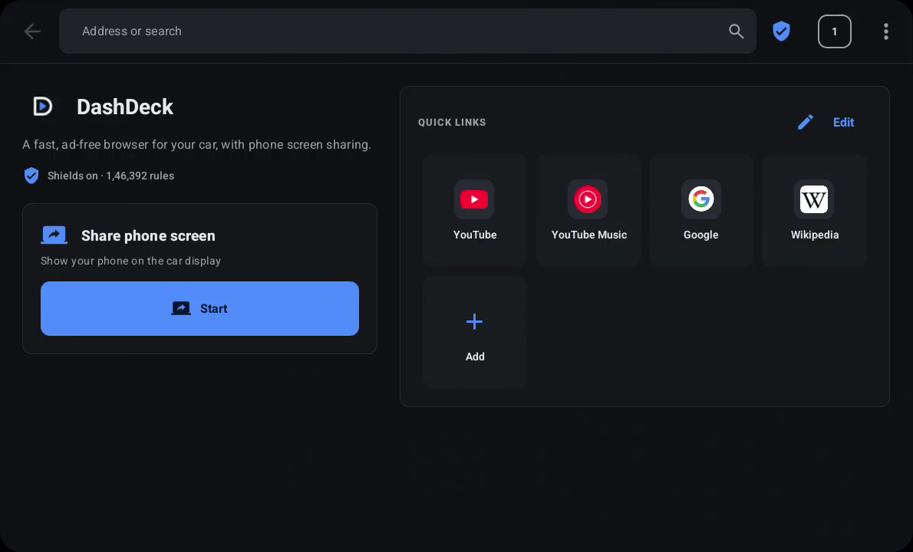
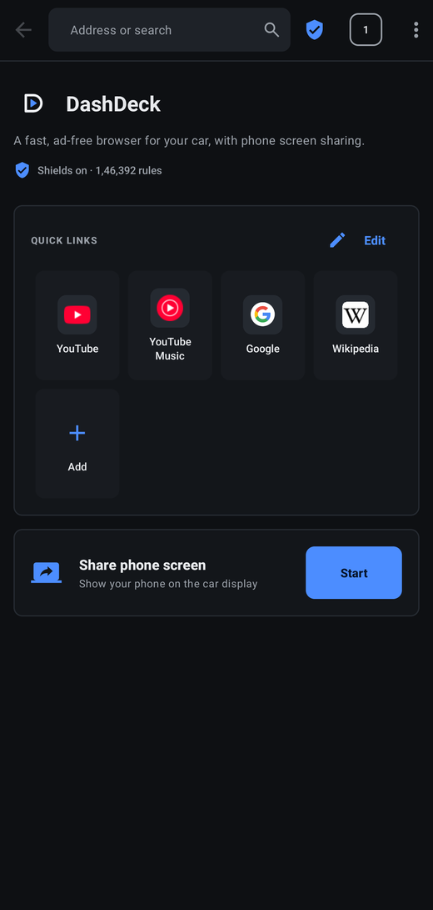
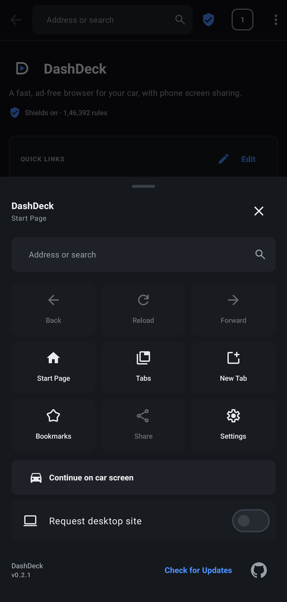
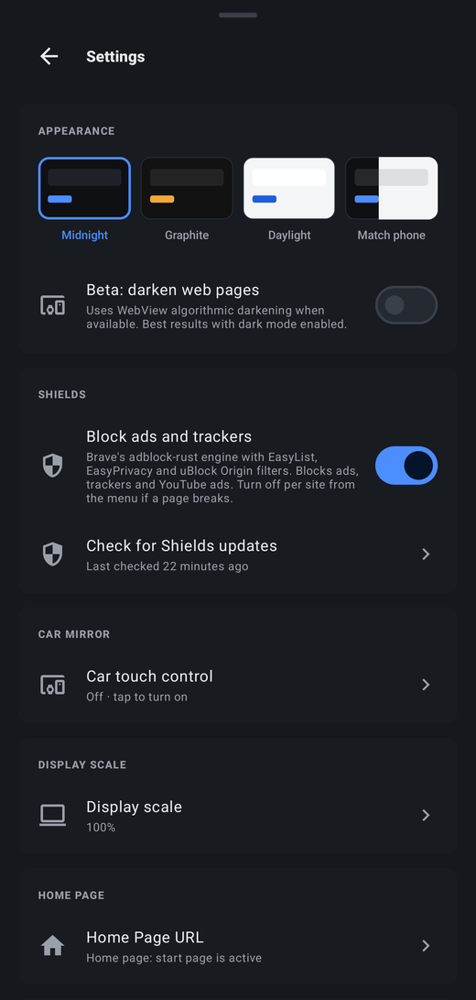

<p align="center">
  
</p>

<h1 align="center">DashDeck</h1>

<p align="center">
  A fast, ad-free web browser for Android Auto, with phone screen sharing.
</p>

<p align="center">
  <a href="https://github.com/sa-fw-an/DashDeck/releases/latest"></a>
  <a href="https://github.com/sa-fw-an/DashDeck/actions/workflows/ci.yml"></a>
  <a href="LICENSE"></a>
</p>

<p align="center">
  
</p>

DashDeck is a fork of [AABrowser](https://github.com/kododake/AABrowser) by
[Kododake](https://github.com/kododake) and AABrowser contributors, licensed under GPLv3.

> [!WARNING]
> DashDeck is for parked vehicles and passengers. Never browse, watch video or share
> your screen while driving.

## Features

- **Car browser.** Full web browsing on the Android Auto display, with tabs, bookmarks,
  quick links and a layout built for car screens.
- **Shields.** Ads, trackers and YouTube ads blocked by Brave's
  [adblock-rust](https://github.com/brave/adblock-rust) engine with EasyList, EasyPrivacy and
  uBlock Origin filters. Lists update themselves and are tested before use. Turn Shields off
  for a single site from the shield in the toolbar.
- **Phone screen sharing.** Show your phone on the car display and control it from the car's
  touch screen (taps, scrolling, dragging).
- **Continue on car screen.** Send the page open on your phone to the car with one tap.
- **Themes.** Midnight, Graphite, Daylight, or match the phone.
- **Private.** No analytics, no accounts, no tracking.

<p align="center">
  
  
  
</p>

## Install

1. Download `DashDeck-x.y.z.apk` from the [latest release](https://github.com/sa-fw-an/DashDeck/releases/latest)
   and install it on your phone (Android 15 or newer).
2. In the Android Auto app on your phone, turn on developer settings (tap **Version** ten
   times), then enable **Unknown sources** in the developer settings.
3. Connect to your car, open the app launcher and choose **DashDeck**.

More detail and troubleshooting: [docs/android-auto.md](docs/android-auto.md).

## Screen sharing and touch

Tap **Start** under **Share phone screen**. Your phone asks to share its screen; once you
accept, the phone appears on the car display.

To control the phone from the car's touch screen, turn on DashDeck under
**Settings → Accessibility → Installed apps** on the phone. Android only allows one app to
tap on another through an accessibility service; DashDeck uses it only to replay touches
made on the mirrored car display.

## Shields

Shields runs Brave's adblock-rust engine locally. Filter lists come with the app and refresh
every few days; a new set is only used after it passes a self-test suite. Engine updates are
signed and tested in a separate process before they are used, and DashDeck falls back to its
built-in engine if one ever misbehaves. See [docs/shields.md](docs/shields.md).

## Building

Requirements: JDK 21, Android SDK with NDK 29, Rust (stable) with the `aarch64-linux-android`
target, and Node.js for regenerating filter resources.

```bash
rustup target add aarch64-linux-android
./gradlew :app:assembleDebug
```

The APK is written to `app/build/renamedApks/debug/`. The Gradle build compiles the Rust
engine in `native/brave-adblock`. Run the tests with:

```bash
./gradlew :app:testDebugUnitTest :app:lintDebug
(cd native/brave-adblock && cargo test --release)
```

## Contributing

See [CONTRIBUTING.md](CONTRIBUTING.md). Security issues: [SECURITY.md](SECURITY.md).

## License

DashDeck is free software under the [GNU General Public License v3.0](LICENSE).

It is a modified version of [AABrowser](https://github.com/kododake/AABrowser), Copyright (C) 2025
AABrowser Contributors, created by [Kododake](https://github.com/kododake). Files derived from
AABrowser keep its copyright and license notice. Modifications Copyright (C) 2026 Safwan Sayeed.
Third-party components and their licenses are listed in [NOTICE](NOTICE).

Made by [Safwan Sayeed](https://safwansayeed.in).
